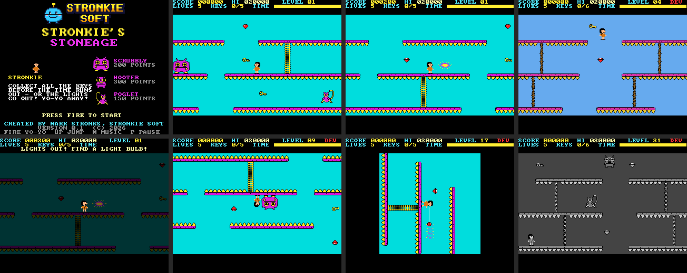

# Stronkie's StoneAge (Amiga 500)

A scrolling platform game for the Amiga 500. Created By Mark Stronks, Stronkie Soft (c) 2026.

Stronkie the caveman, armed with a yo-yo, collects every key of a level before the time runs out, deep in the
jungle. He jumps along fallen tree trunks, climbs vines (ropes and chains in later levels), slides down diagonally when he steps off a
ledge - and a long drop is fatal. The yo-yo clears the Scrubblies, Hooters and Poglets and pops the
rising balloons and falling daggers, but not in the dark: when the timer hits zero the lights go out.
Light bulbs give time and light back, gems give points. After the 8 levels the game loops with a twist:
upside down, turned 90 degrees, black and white with flashes - with faster monsters every loop.



## Files

| File | What |
|---|---|
| `StronkiesStoneAge_V0.2.adf` | the game, bootable floppy (packed, with the hard disk installer) |
| `StronkiesStoneAge_Demo.adf` | free demo: levels 1 and 2 |
| `StronkiesStoneAge_V0.2_harddrive.zip` | drawer for a hard disk / CF card |
| `StronkiesStoneAge_V0.2_WHDLoad.zip` | WHDLoad install (own slave, no Kickstart image needed; F10 quits) |
| `StronkiesStoneAge_Demo_WHDLoad.zip` | WHDLoad install of the free demo |
| `print/` | manual (A5), fold-up box (A3), disk labels (A4) |
| `levels.txt` | all 8 levels as text |
| `ReadMe.txt` | the ReadMe that goes on the disk |

## The rules
- Collect all keys of a level (the panel shows KEYS x/y). Time left: 10 points a second.
- Up = jump (up + left/right = sideways), up/down at a ladder, rope or chain = climb, left/right at a floor = step off.
- Stepping off a ledge: a diagonal slide (2 across, 2 down a frame). A drop of more than 100 pixels
  (more than one floor) kills, so does falling out of the bottom.
- Fire = the yo-yo (64 pixels out and back). Monsters go poof (Scrubbly 200, Hooter 300, Poglet 150) and
  come back after about 8 seconds when Stronkie is away from their place. Balloons / daggers pop (50) - only while it is light.
- Timer at zero: the lights go out (dark playfield, dim monsters, the yo-yo misses balloons and daggers).
  A light bulb: +15 s and the light back. Key 100, gem 250, bulb 100.
- 5 lives, extra at 20000 and every 30000. After level 8: 5000 bonus and the next loop:
  loop 2 upside down, loop 3 turned 90 degrees, loop 4 black and white with flashes, then normal again (faster).

## Controls
Joystick port 2 or cursor keys + Space. M music, P pause, Esc end the game (on the title: quit), F10 quit.

**Developer mode:** CTRL + ALT + D on the title ("DEV MODE" appears). Left/right picks the start level,
up/down the view (normal, flipped, turned, black and white). In the game: N = level done, I = invulnerable,
T = 3 seconds left. No lives are lost and no high score is saved in dev mode.

## Requirements
Amiga 500, 68000, Kickstart / Workbench 3.1 (1.3 works too), 1 MB chip RAM (8372A Agnus). Uses about 230 KB chip
and 55 KB other memory. Joystick in port 2.

## How it works
- Dual playfield, 3 + 3 planes: in front the level (60 x 12 tiles of 16 pixels, 960 x 192, colours 1-7), drawn once
  into an interleaved bitmap; behind it the jungle (320 pixels wide, repeating, colours 9-15) at half speed.
  Both scroll with their own bitplane pointers and BPLCON1 delay (`src/display.i`); colour 0 is a copper sky
  gradient, one colour per line. The panels above and below are the 4-plane screen bitmap. Upside down = the same bitmap shown from the last line up
  (negative modulo). Turned 90 degrees = a second layout of the bitmap (320 x 960, tiles turned by `tools/gen.py`),
  scrolled vertically.
- The yo-yo string is XORed into the level bitmap (gold) and XORed away again the next frame.
- All actors are hardware sprites with a vertical multiplexer: channels 0+1 Stronkie, 2 the yo-yo,
  3 balloons/daggers, 4+5 and 6+7 the monsters (32 pixels wide). Sprites are stored normal and turned.
- 68000 only (`vasmm68k_mot -m68000`), everything polled once per frame, the system is given back on exit.

## Building
Needs the Stronkie Soft Amiga toolkit (`. amiga-toolkit/setup.sh`).
```
VER=0.3 tools/build.sh          # levels check -> gen.py -> assemble -> pack -> ADFs + zips
tests/run_tests.sh              # level checker, physics check in the 68000 harness, screenshots
python3 tools/make_print.py 0.2 # manual, box, disk labels
```
- `tools/levels.py` - the 8 levels (built with a small builder) and a copy of the player physics; every level is
  checked: all keys, gems and bulbs reachable from the start without a deadly drop, and no trap (from every
  place Stronkie can reach he can get back to the start).
- `tests/physics.py` - 64 jumps and slides from random places on 4 levels, played on the real game code in the
  toolkit's 68000 harness: they must land on the same pixel as the checker (or die where it says).
- `tools/gen.py` - `src/data_gen.i`: levels, tiles (normal + turned), sprites (normal + turned), palettes, font,
  logo, music, sound effects. `tools/art.py` - the sprites as text art.
- `src/main.s` + `sys.i` (system, input, sound, text), `display.i` (copper, views, sprites), `game.i`, `title.i`.
  `src/install.s` - hard disk installer. `src/whdload.s` - WHDLoad slave.

## Changelog

### Not yet on itch
**V0.3 (27 Nov 2026)** - the Stronkie Soft boot intro (SSIntro, from the toolkit) plays before the game on the
floppy; hard drive and WHDLoad versions start the game straight away. The demo stays V0.2.

### On itch (published 27 Nov 2026)
**V0.2 (27 Nov 2026)** - pictures, classical music, jungle life
- Loading picture (32 colours): Stronkie throwing his yo-yo in the jungle with a Scrubbly, a Hooter, a monkey
  and parrots. A small loader (`SStoneAge`) shows it while it loads `StoneAge.game`.
- Title screen is now a picture: the jungle, the game's logo, the monsters with their points and Stronkie
  walking on a tree trunk; the high score table on the same picture.
- Classical music with a flute sound: Bach's Minuet in G (title), Grieg's In the Hall of the Mountain King
  (game), Beethoven's Ode to Joy (game won).
- Jungle sounds (parrots, a monkey, crickets) at a low volume when the sound channel is free.
- Now and then a monkey swings by on a vine or walks along the trunk, and parrots fly across: in the game and
  on the title.

**V0.1 (27 Nov 2026)** - the first version
- 8 scrolling jungle levels: Jungle Edge, Monkey Trees, Snake River Gap (vines), Rope Bridge, Hanging Ropes,
  Dino Nest (ropes), Temple Chains, Volcano Jungle (chains). Tree trunks to walk on, a jungle behind on the
  second playfield that scrolls at half speed (parallax), a sky gradient per level (morning, day, mist,
  sunset, night, volcano...). Score panel and message panel in bamboo frames.
- Stronkie: walk, jump, climb, diagonal slide off ledges, deadly long drops and pits; the yo-yo.
- Scrubblies, Hooters, Poglets (in the style of Mark's pictures), balloons and daggers.
- Timer bar, lights out at zero (the yo-yo misses balloons and daggers in the dark), light bulbs, gems.
- Endless loops: upside down, turned 90 degrees, black and white with flashes; faster monsters.
- Title with the monsters, high score table + name entry (saved), music and sound effects, developer mode,
  free demo (levels 1-2), hard disk installer, WHDLoad (own slave), print kit.
